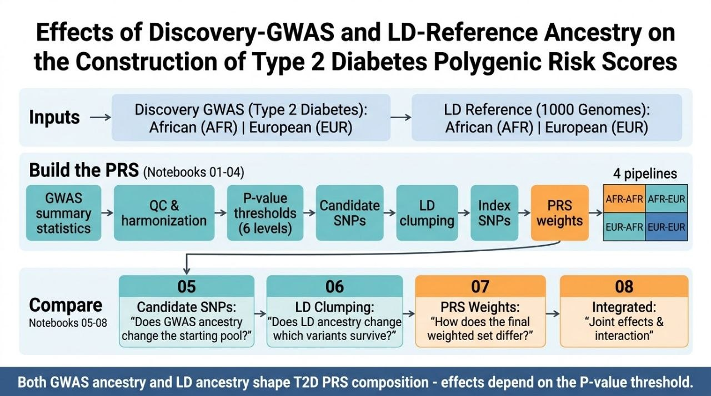

# Effects of Discovery-GWAS and LD-Reference Ancestry on the Construction of Type 2 Diabetes Polygenic Risk Scores

A 2 × 2 factorial comparison of how the ancestry of the **discovery GWAS** and the ancestry of the **LD reference panel** shape the composition of a Type 2 Diabetes (T2D) polygenic risk score (PRS) built by P-value thresholding and LD clumping.

> **Scope:** this project studies PRS *construction and composition* (which variants and weights end up in the score). It does **not** evaluate individual-level predictive accuracy.

---

## Research question

Do the ancestry of the discovery GWAS and the ancestry of the LD reference independently or jointly influence the genetic composition of a T2D PRS?

## Design

| Pipeline | Discovery GWAS | LD reference |
|---|---|---|
| AFR-AFR | African ancestry | 1000 Genomes AFR |
| AFR-EUR | African ancestry | 1000 Genomes EUR |
| EUR-AFR | European ancestry | 1000 Genomes AFR |
| EUR-EUR | European ancestry | 1000 Genomes EUR |

- **Phenotype:** Type 2 Diabetes (PheCode 250.2), Million Veteran Program (MVP) GWAS summary statistics for African and European, and 1000 Genomes Project Phase 3 for African and European LD-reference populations
- **P-value thresholds (all pipelines):** 5×10⁻⁸, 1×10⁻⁵, 1×10⁻⁴, 1×10⁻³, 0.01, 0.05.
- Changing one factor while holding the other fixed separates the GWAS effect from the LD effect and allows an interaction check.

## Workflow


## Notebooks

### Part 1: Pipelines (one per ancestry combination, GWAS through PRS weights)

| Notebook | Pipeline | Output |
|---|---|---|
| `PRS_T2D_A-Gwas+A-LD.ipynb` | AFR GWAS + AFR LD | candidate SNPs, clumped index SNPs, weights |
| `PRS_T2D_A-Gwas+E-LD.ipynb` | AFR GWAS + EUR LD | candidate SNPs, clumped index SNPs, weights |
| `PRS_T2D_E-Gwas+A-LD.ipynb` | EUR GWAS + AFR LD | candidate SNPs, clumped index SNPs, weights |
| `PRS_T2D_E-Gwas+E-LD.ipynb` | EUR GWAS + EUR LD | candidate SNPs, clumped index SNPs, weights |


### Part 2: Comparisons

| Notebook | Question | Main factor |
|---|---|---|
| `PRS_Candidate_SNP_Comparison.ipynb` | Does GWAS ancestry change the initial variant pool? | GWAS ancestry |
| `PRS_LD_Clumping_Comparison.ipynb` | Does LD-reference ancestry change which independent variants are kept? | LD ancestry |
| `PRS_PRS_Weight_Comparison.ipynb` | How does the final weighted variant set differ (BETA, EAF, P, overlap)? | GWAS + LD |
| `PRS_Integrated_Comparison.ipynb` | What are the separate and joint effects? | Both |

## Key results

### 1. Candidate SNPs
- The same GWAS gave identical candidate counts under both LD references (pipeline consistency control passed).
- The EUR GWAS produced about 2.0-2.5x more candidates (66,996 vs 27,292 at 5×10⁻⁸; 3,066,477 vs 1,500,187 at 0.05).
- 92% of AFR candidates at 5×10⁻⁸ were also in the EUR set; only 37% of EUR candidates were in the AFR set.

### 2. LD clumping 

Index SNPs per pipeline:

| Threshold | AFR-AFR | AFR-EUR | EUR-AFR | EUR-EUR |
|---|---|---|---|---|
| 5×10⁻⁸ | 1,710 | 633 | 4,944 | 2,063 |
| 1×10⁻⁵ | 4,305 | 1,636 | 16,558 | 9,216 |
| 1×10⁻⁴ | 7,666 | 3,302 | 37,511 | 25,465 |
| 1×10⁻³ | 19,691 | 11,288 | 107,335 | 83,925 |
| 0.01 | 90,187 | 74,325 | 364,262 | 319,256 |
| 0.05 | 357,804 | 358,128 | 920,240 | 842,495 |

- AFR LD retained 2.7x (AFR GWAS) and 2.4x (EUR GWAS) more index SNPs than EUR LD at 5×10⁻⁸.
- Equal counts do not mean equal content: at P ≤ 0.05 the AFR-GWAS counts were nearly identical, yet 224,817 variants were shared (about 63% of each set; Jaccard 0.46).
- Jaccard overlap between LD references was lowest at strict thresholds (0.28 for AFR GWAS, 0.32 for EUR GWAS at 5×10⁻⁸).

### 3. PRS weights 
- Index counts equal weight counts in all 24 files.
- EUR weight sets have larger median |BETA| and much higher median EAF (0.78-0.999) than AFR sets (0.01-0.46). No MAF filter was applied, so low-frequency variants are included.
- These are differences in composition, not in score quality.

### 4. Integrated comparison 
Share of index SNPs lost when switching AFR LD to EUR LD:

| Threshold | AFR GWAS | EUR GWAS |
|---|---|---|
| 5×10⁻⁸ | 63% | 58% |
| 1×10⁻⁵ | 62% | 44% |
| 1×10⁻⁴ | 57% | 32% |
| 1×10⁻³ | 43% | 22% |
| 0.01 | 18% | 12% |
| 0.05 | ~0% | 8% |

The LD-reference effect is larger for the AFR GWAS at most thresholds, so the two factors interact (descriptive, no statistical test).

## Tools
Python
Google colab
PLINK 2
NumPy
Pandas

## Data quality note

A weight-file audit found that at multi-allelic sites some EUR weight rows carried the wrong allele's BETA, EAF and P (16-1,911 rows per file, 0.2-0.8%). Clumping and index SNP selection were not affected. Weights were rebuilt from the candidate files (lowest-P allele retained, assumed to match the clumping selection) and saved as `*_FIXED.tsv`. The corrected files contain the same SNPs as the originals, and all retained variants meet their thresholds. No issues were found in the AFR files. Audit summary: `weight_fix_report.tsv`.

## Conclusions

- Discovery-GWAS ancestry sets the size and identity of the starting variant pool.
- LD-reference ancestry changes which independent variants survive clumping, even when counts converge.
- Both factors shape T2D PRS composition, and their effects depend on the P-value threshold and on each other.
- For T2D, a condition with a large burden across populations, this suggests that ancestry-specific choices in score construction can change which variants a score is built from, which may contribute to poor portability of scores across ancestries. Predictive performance was not tested.

## Limitations

- No individual-level validation; a follow-up should test the scores in independent AFR and EUR cohorts.
- No MAF filter; rare variants likely contribute to large EUR effect sizes (untested).
- Variant overlap is by SNP ID, not allele-harmonized or locus-based.
- The 1000 Genomes AFR and EUR panels differ in size and composition.
- Mechanistic explanations (e.g., shorter LD blocks in AFR) are interpretations, not tested here.

## Reproducibility

- Runs in Google Colab with data on Google Drive.
- Python: pandas, numpy, matplotlib; PLINK for clumping.
- TODO: clumping parameters (r², window), GWAS sample sizes, 1000 Genomes panel sizes, genome build.

## Repository structure

```
notebooks/    01-04 pipelines, 05-08 comparisons
results/      summary tables (weight_summary.tsv, LD_clumping_summary.tsv, ...)
figures/
README.md
```
